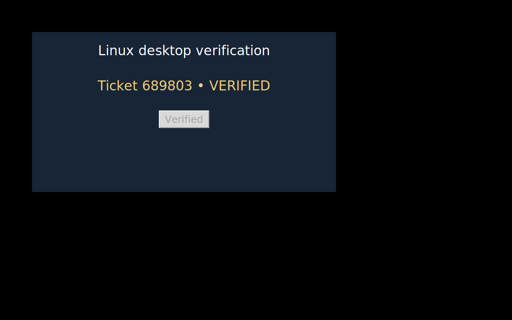
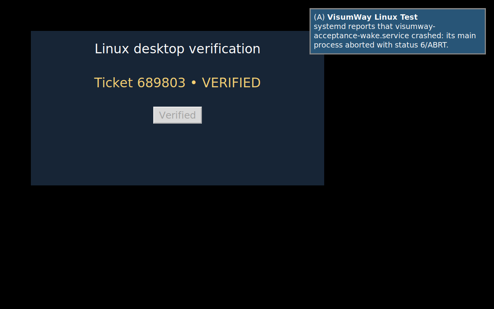

# Linux validation

On November 18, 2026, the public v0.2.8 source archive was installed in a
fresh Python 3.12 environment on Ubuntu 24.04.3 under WSL2. An isolated
1280×800 Xvfb desktop ran a disposable Tk app and the native Dunst
notification server. Native scrot, user D-Bus, systemd, and Linux Codex
CLI 0.147.0 supplied the real external components.

## Results

| Check | Result |
| --- | --- |
| Source installation and unit suite | Passed. The final patch suite ran 95 tests, with 93 passing and two platform-specific cases skipped. |
| Shared setup | A second agent reused the installation with the configuration unchanged. |
| Native capture | scrot returned a real 1280×800 PNG containing the fixture's randomized ticket and state. |
| Real model observation | Signed-in native Codex used the MCP capture to read ticket 689803 and the VERIFIED state. |
| Sample watch | Changed image delivered, unchanged image skipped, explicit stop and expiry passed. |
| Notification ownership | The owner had 13 MCP tools. The other agent had 12 shared tools and its notification call was denied. |
| Native crash event | A disposable systemd user unit aborted. The installed timer collected its genuine dumped-process journal record and did not replay it. |
| Signed-in wake | A second crash woke Codex and generated a native Dunst alert in approximately 10 seconds. |
| Notification action | Dunst's Open action launched xterm with the same saved Codex session. Its original reply was visible after normal trust and update prompts. |
| Listener restart | Passed after the fix described below. |
| Idle | No additional model wakes in a measured 30-second interval. Listener CPU time increased by 0.01 seconds. |
| Distribution restart | The listener and journal timer started automatically when Ubuntu was restarted. Wakes remained paused. |
| Uninstall/purge | Removed the test home, listener service, and journal timer. |





[Machine-readable results](validation/linux-ubuntu24-wsl2-x11.json)

## Listener recovery fix

The first systemd restart found a fresh heartbeat from the stopped
listener. That delayed its replacement even though the OS lock was free.
v0.2.9 relies on the existing exclusive process lock, which the operating
system releases on process exit. A regression test covers the stale
heartbeat, and real service restart and distribution restart passed with
the fix installed.

## Reproduce on an X11 desktop

Use a normal user with a working systemd user manager, a desktop
notification server, and an installed screenshot backend such as scrot.
For this test, Xvfb supplied the X11 display and Dunst supplied notifications.
On a normal desktop, use the session's existing display and notifier.

Install into a virtual environment and identify the installing agent.
Review the generated plan and check the existing account before enabling
wakes.

```sh
python3 -m venv .venv
. .venv/bin/activate
python -m pip install .
visumway setup --agent codex
visumway verify
visumway agent list
visumway agent probe codex
visumway wakes preview
visumway wakes enable --agent codex
```

The probe and each enabled wake perform real model inference. Connect the
same installed MCP command from each agent. If the agent host filters its
environment, provide the session values for `DISPLAY`, `XDG_RUNTIME_DIR`,
and `DBUS_SESSION_BUS_ADDRESS` explicitly in the MCP server configuration.
For a Wayland session, the capture backend also needs its session access.
Launch the listener from that graphical environment or configure those
values in the user service's environment.

To exercise a real user-journal failure, create a disposable transient
service. The following command intentionally aborts only its test process.

```sh
systemd-run --user --unit=visumway-test-crash --collect \
  --property=LimitCORE=0 python3 -c 'import os; os.abort()'
visumway events
visumway incidents
```

Allow time for the periodic journal timer, aggregation, and the agent
response. Check the actual journal record, event, notification, and resumed
conversation. Finish with `visumway wakes pause --agent codex` and, in a
disposable installation, `visumway uninstall --purge`.

## Coverage still pending

The test used WSL2 and an Xvfb desktop. It does not establish GNOME/KDE
notification behavior, Wayland capture permissions, or physical desktop
login and reboot behavior. The WSL distribution restart retained the
shared kernel. The journal collector reads user-visible records at periodic
intervals and cannot guarantee coverage of protected system-wide crashes.
Direct app-control reads and the native buffered window feed remain Windows
features. Linux in this test used the whole-desktop sampled watch.

X11 test utilities were installed in the Ubuntu distribution. The test's
services, temporary environments, and temporary account link were removed.
